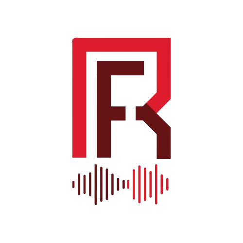
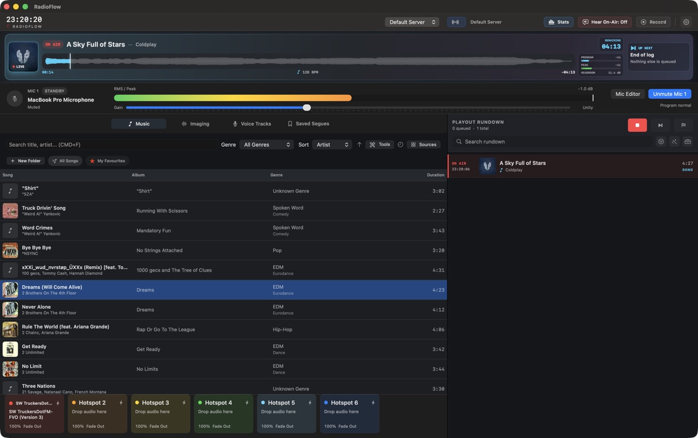
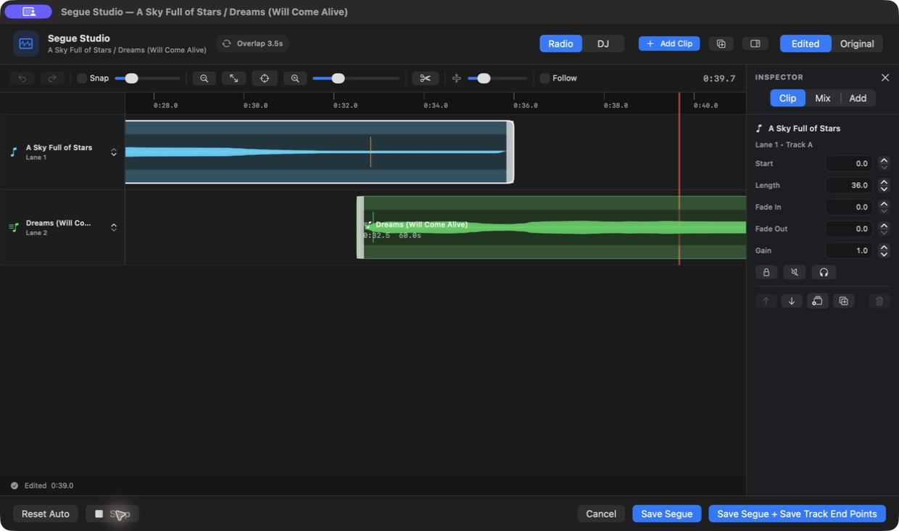
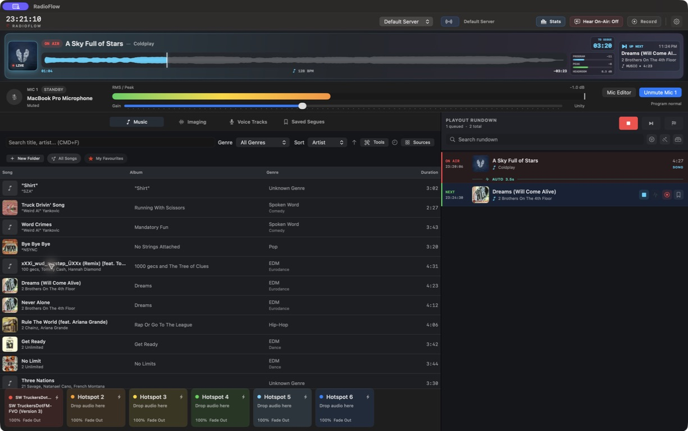
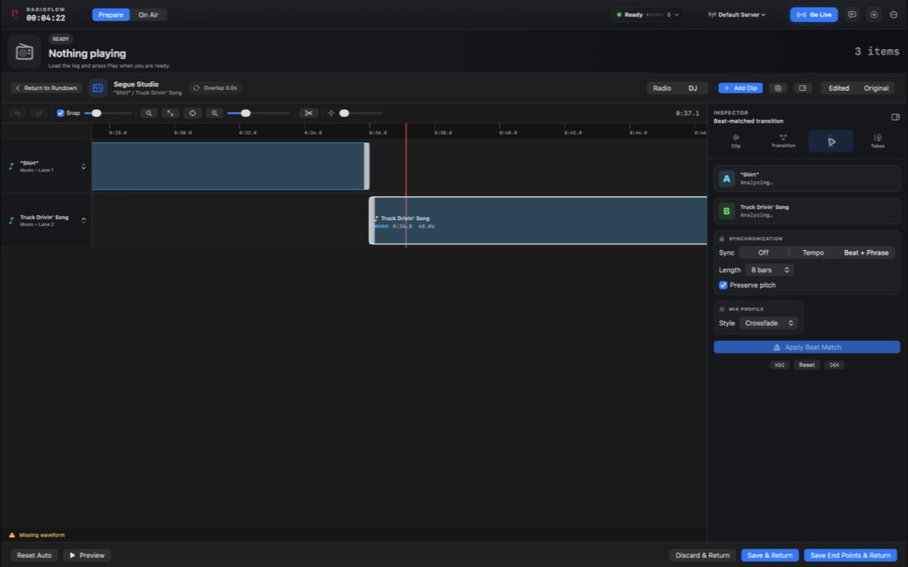
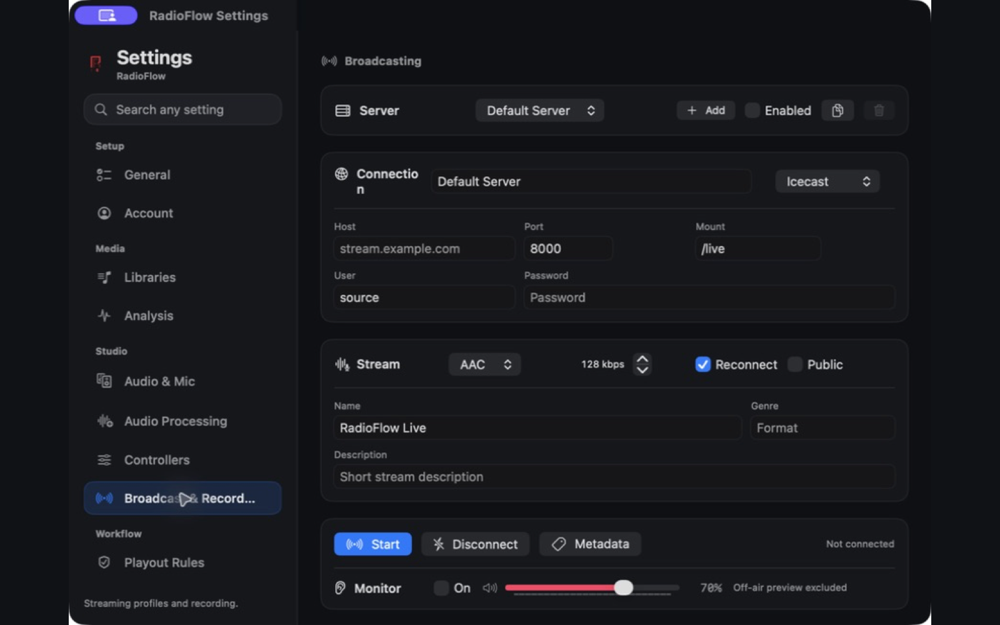
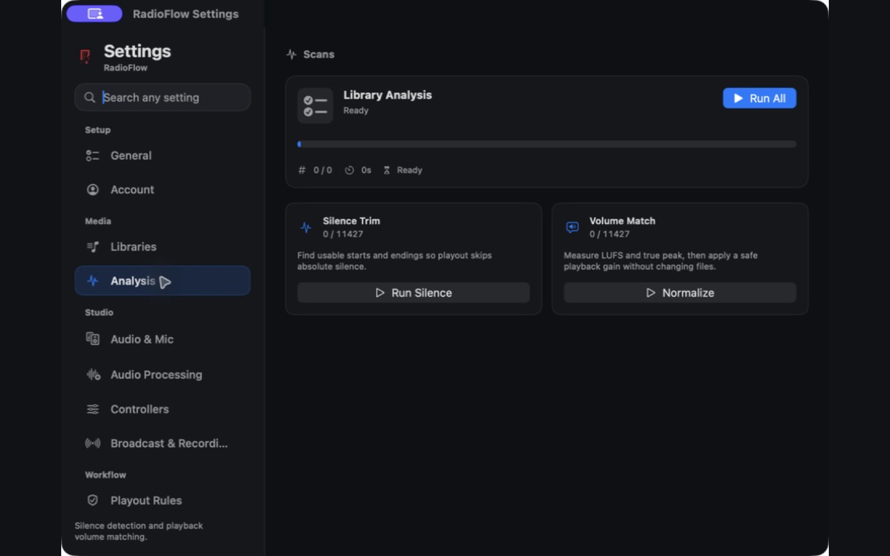
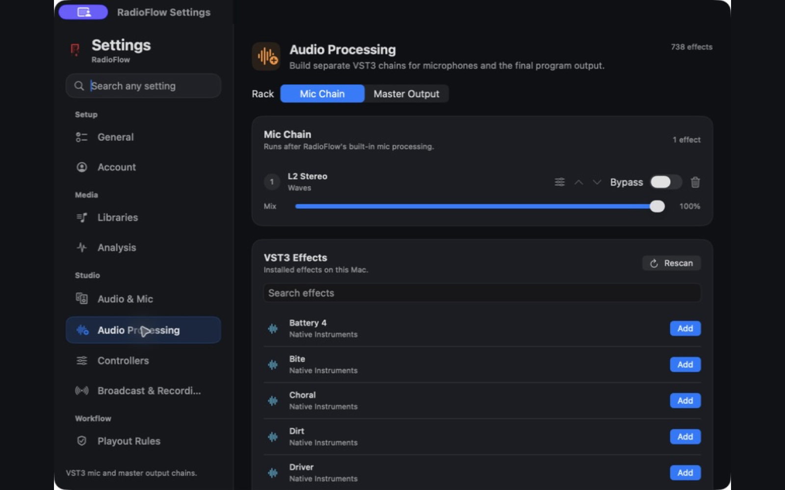

# RadioFlow

Radio automation and live streaming software for the Mac.

[radioflow.app](https://radioflow.app)

RadioFlow is a commercial app I design and build on my own. The source is private, so this repo is an overview of what it does and how it works. If you'd like to look at the code, reach out and I can give you access.



## What it does

RadioFlow runs a radio station from one Mac. You build a playout log of songs, station imaging, and voice tracks, and it plays them back to back with smooth transitions. You can take over live with a mic and stream the whole thing to an Icecast or Shoutcast server.

- Two deck playout with layered overlays for imaging and voice tracks
- **Segue Studio**, a timeline editor for shaping the transition between any two songs
- DJ mode and Auto-DJ with tempo matching and phrase aware transitions
- Mic processing with a built in EQ, compressor, and limiter, plus support for VST3 plugins
- Automatic track analysis: loudness, true peak, waveform, tempo, beat grid, and musical key
- Streams AAC or MP3 to Icecast and Shoutcast
- MIDI Learn, hotspots, program recording, and an on air safety panel

| Segue Studio | Library |
| --- | --- |
|  |  |

| DJ mode | Broadcasting |
| --- | --- |
|  |  |

## Stack

**Mac app**
- Swift, SwiftUI, and AppKit
- AVAudioEngine, Core Audio, and Accelerate (vDSP) for audio
- Objective-C++ bridge to host VST3 plugins
- Network.framework for streaming, CoreMIDI for controllers
- SQLite for the analysis cache, Keychain for credentials
- Sparkle for auto updates

**Website and accounts** ([radioflow.app](https://radioflow.app))
- Next.js and React on Cloudflare Workers
- Supabase for auth and Postgres
- Stripe for subscriptions

## How the audio works

```
 Deck A ─┐
 Deck B ─┤
Overlays ┼──► program mix ──► master processing ──┬──► speakers
     Mic ┘     (EQ, comp, VST3)                   ├──► recorder
                                                  └──► encoder ──► Icecast / Shoutcast
                                                       (AAC or MP3)
```

Everything that goes out (speakers, recordings, and the stream) comes from the same processed mix, so what you hear is what listeners hear. Preview audio for cueing up the next track is kept on a separate path and never reaches the stream.

## Problems I had to solve

**Stream clock drift.** Early versions had a faint fizz on the stream and a tiny dropout every 8 seconds or so. The broadcast feed was working out its read position from the system clock, and at 48 kHz it ended up re-reading samples on most render cycles. I replaced it with a clock that counts frames directly, which fixed both problems.

**Live encoding.** AAC goes through AVAudioConverter, and I wrote the ADTS framing by hand so the stream is readable by any player. MP3 runs through a LAME process that the app manages and restarts safely. The stream reconnects on its own if the connection drops. To test all this without a real station, I built a small Icecast-compatible server into the app plus a separate local test lab.

**Sample accurate transitions.** Fades and volume changes are scheduled against Core Audio's host clock instead of timers, so transitions land on the exact sample no matter what the UI is doing.

**Hosting VST3 plugins from Swift.** Plugins are written in C++, so there's an Objective-C++ bridge between them and the Swift app. Scanning runs in a separate process so a broken plugin can't crash the app, and dry/wet mixing is latency compensated. The native audio code is tested under Address Sanitizer and Undefined Behavior Sanitizer in CI.

**One pass track analysis.** Each song is decoded once, and that single pass produces loudness and true peak, the waveform, tempo and beat grid, and key. Results are cached in SQLite and versioned so they can be recomputed when the analysis code improves.

**Real time safety.** The audio render thread avoids allocating memory, since a stall there is an audible glitch on air. Mic input from any device is converted to one stereo 48 kHz format before processing, so the rest of the chain only has to deal with one format.

## Engineering

- About 99,000 lines of Swift, with 330 unit tests
- GitHub Actions CI builds the app, runs the tests with coverage, and runs the native audio tests under sanitizers
- Releases are a single script that builds, code signs, notarizes with Apple, and publishes a signed update feed
- Over 17 public releases since 1.0, now on version 1.6

| Analysis | Mic processing |
| --- | --- |
|  |  |

## Contact

Caden Johnson
